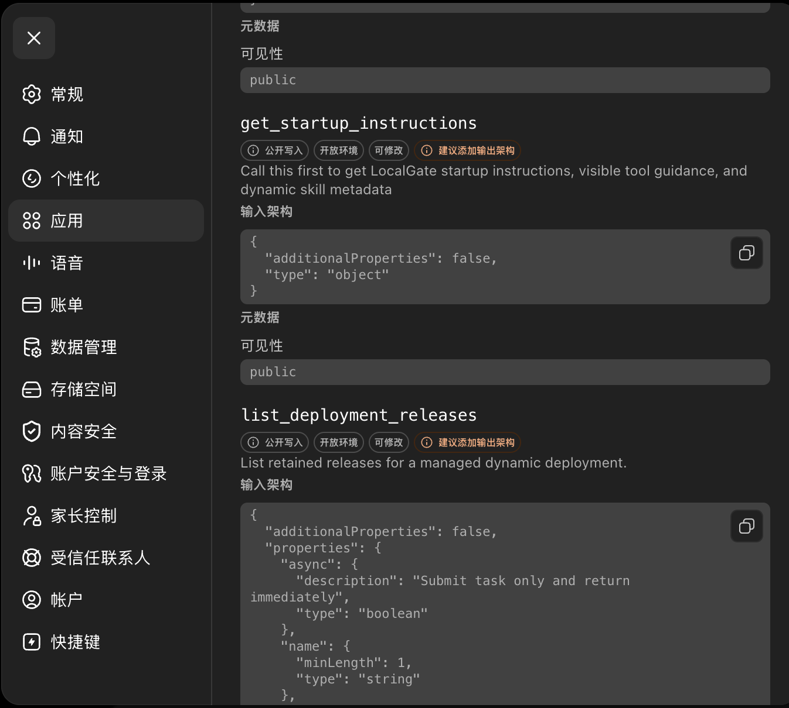
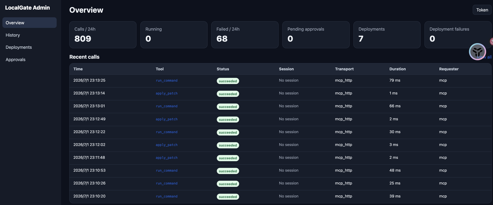
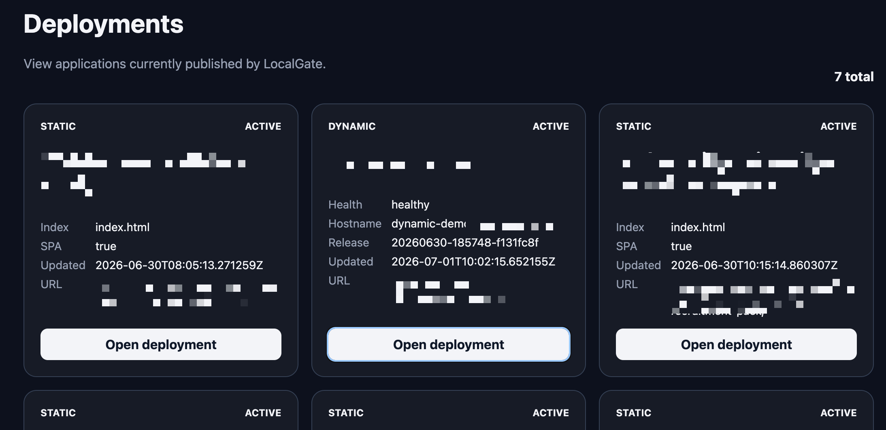
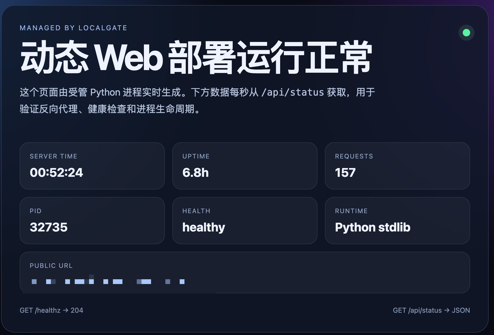

# LocalGate

> **在线 Agent + LocalGate = 一个真正能在本地开发、执行任务并完成交付的工作型 Agent。**
>
> 很多在线 Agent 会思考、会对话，但缺少真实的开发和工作能力。接入 LocalGate 后，它可以安全地操作本地文件、修改代码、运行命令、启动长期进程、执行审批流程并完成部署。

**多种接入模式：MCP + Skills；有网络访问或者有 MCP 都可接入。**

**自描述 + Skills 支持 + 静态应用部署 + 动态应用部署 + 后台管理与审计**

LocalGate 不只是给 Agent 增加几个工具，而是提供从能力发现、使用指引、执行控制，到应用发布和事后追踪的一整套工作闭环。

**把 AI Agent 的本地执行能力，从“直接给 Shell”升级为一套可隔离、可审批、可观察、可部署的控制平面。**

LocalGate 位于 AI Agent 与操作系统之间，把文件操作、命令执行、交互式进程和应用部署封装成具名工具。客户端可以通过 stdio MCP、HTTP MCP 或普通 HTTP API 使用同一套能力，而目录范围、命令策略、审批规则、日志和审计都由服务端统一控制。

```text
AI Agent / MCP Client / HTTP Client
                 │
       stdio MCP │ HTTP MCP │ REST
                 ▼
┌─────────────────────────────────────┐
│              LocalGate              │
│ Tool Registry · Task · Session      │
│ Approval · Audit · Workspace Policy │
│ Static/Dynamic Deployment           │
└─────────────────────────────────────┘
                 │
         Filesystem · Shell · Runtime
```

<p align="center">
  
</p>

<p align="center"><sub>ChatGPT / 在线 Agent 通过 MCP 或 Skills 接入 LocalGate</sub></p>

## 为什么是 LocalGate

### 1. 给 Agent 工具，而不是把整台机器交给它

LocalGate 暴露的是 `read_file`、`apply_patch`、`run_command`、`deploy_tool` 等具名工具。每个调用都要经过 workspace、路径、命令、环境变量和 Shell 语法策略检查。

这意味着你可以让 Agent 真正完成开发和运维工作，同时把访问范围限制在指定项目目录，而不是开放一个无边界的远程终端。

### 2. 审批不是弹窗，而是执行状态机的一部分

高风险操作可以在真正执行前进入 `pending_approval`。审批记录会绑定原始 Task、工具、参数摘要、workspace 和请求者。

批准后继续执行的是**同一个 Task**，客户端不需要重新发起命令，也不会因为“批准后重试”自然产生第二份任务。这使审批可以嵌入 Agent 的自动化流程，而不是成为流程之外的人工补丁。

### 3. Task 与 Session 分离，短任务和长进程都能正确管理

- **Task** 负责一次性工作：读写文件、执行测试、构建产物、发布站点。
- **Session** 负责持续工作：REPL、开发服务器、watch 进程、交互式终端。

Task 有状态、增量日志、事件流、取消和最终结果；Session 有独立终端缓冲、stdin 和生命周期。客户端不需要拿一个“万能 Shell 接口”勉强处理所有执行模式。

### 4. MCP + Skills，多种环境都能接入

LocalGate 不要求在线 Agent 必须原生支持某一种固定协议：

- **有 MCP 能力**：直接通过 stdio MCP 或 Streamable HTTP MCP 发现并调用工具。
- **只有网络访问能力**：通过 Skills 获取调用规则，再使用普通 HTTP API 执行任务。
- **本地客户端**：可以使用 stdio MCP，避免额外开放网络服务。
- **远程在线 Agent**：可以通过 HTTP MCP，或通过 Skills + HTTP API 接入。

因此，只要 Agent 能访问网络，或者本身支持 MCP，就可以接入 LocalGate。Skills 负责告诉 Agent 如何发现工具、构造参数、处理 Task/Session、审批和结果；MCP 与 HTTP API 则负责真正执行。

同一套能力支持三种传输方式：

- **stdio MCP**：适合桌面 Agent 和本地 MCP Host。
- **Streamable HTTP MCP**：适合远程或常驻 MCP 服务。
- **REST API**：适合脚本、后台服务、CI 和管理系统集成。

工具定义、策略和审计不会因为传输方式不同而分裂成多套实现。

### 5. 原生支持标准 Skills，按需扩展模型能力

除了仓库内置的 LocalGate 使用 Skills，LocalGate 还原生支持标准 `SKILL.md` 目录结构。你可以安装任意面向 Agent 的通用 Skill，用它补充领域知识、操作流程、工具选择规则和任务执行规范，而不需要修改 LocalGate 本身。

LocalGate 会扫描两个标准位置：

```text
~/.agents/skills/<skill-name>/SKILL.md
<workspace>/.agents/skills/<skill-name>/SKILL.md
```

这套机制具备：

- **动态安装**：把 Skill 目录复制、解压、克隆或软链接到上述目录后，下一次调用 `get_startup_instructions` 时即可被发现，通常无需重新编译或重启 LocalGate。
- **全局与项目级作用域**：全局 Skills 可以被多个 workspace 共用，项目级 Skills 只服务于当前 workspace。
- **标准 Frontmatter**：读取 `name`、`description` 和 `disable-model-invocation` 等字段。
- **渐进式披露**：启动阶段只向模型披露 Skill 的名称、简介和文件位置；只有任务与描述匹配时，模型才使用 `read_file` 读取完整 `SKILL.md` 及其引用内容。
- **上下文节省**：不会在每次请求中把所有 Skill 正文全部塞进提示词，减少无关上下文和 Token 消耗。
- **可控可见性**：设置 `disable-model-invocation: true` 的 Skill 不会出现在模型可见列表中。
- **目录与软链接兼容**：支持标准 Skill 目录，也支持通过软链接管理共享 Skill 集合。

渐进式披露流程：

```text
扫描 Skills 目录
      │
      ▼
仅披露 name / description / location
      │
      │ 任务与 Skill 描述匹配
      ▼
read_file 读取对应 SKILL.md
      │
      ▼
按 Skill 指引完成当前任务
```

因此，LocalGate 不只是提供一组固定工具，还可以作为标准 Skills 的运行入口，让模型能力随着 Skill 的安装和更新持续扩展。

### 6. Agent 可以从改代码一路走到部署

LocalGate 不只提供文件和命令工具，还内置静态与动态应用部署：

- 静态目录发布
- 动态进程监督
- 健康检查
- stdout/stderr 日志轮转
- 崩溃重启
- Release 保留
- 原版本回滚
- 控制面与 deployment 应用面使用独立监听端口，并继续执行 Host 校验

Agent 可以在同一个受控执行面中完成“修改代码 → 运行测试 → 构建 → 部署 → 检查日志 → 回滚”。

### 7. 默认面向真实机器的安全边界

LocalGate 的限制不是客户端约定，而是在服务端执行：

- workspace 根目录隔离
- 路径拒绝列表
- 命令 allowlist / denylist
- Shell 管道、重定向、后台执行和命令替换开关
- 环境变量 allowlist
- HTTP Bearer 鉴权
- 高风险工具审批
- 输出大小与执行超时限制
- 敏感字段脱敏与审计记录

### 8. 用 MCP 文件对象打通在线 Agent 与本地文件系统

在线 Agent 通常运行在隔离环境中，不能直接访问用户电脑上的路径，也很难主动连接本地上传接口。LocalGate 的 `upload_file` 不要求 Agent 先申请临时上传 Token，而是直接使用 MCP 宿主提供的文件对象。

当用户在 ChatGPT 中上传文件时，ChatGPT 会为该文件签发短期可访问 URL，并把文件对象作为 MCP 工具参数传给 LocalGate。LocalGate 再将文件下载到经过 workspace 校验的本地绝对路径。

```text
用户在 ChatGPT 上传文件
          │
          │ ChatGPT 文件对象
          │ file_id / file_name / mime_type / temporary download_url
          ▼
   MCP tools/call: upload_file
          │
          ▼
LocalGate 下载并校验目标路径
          │
          ▼
本地 workspace 文件系统
```

这样，在线 Agent 即使存在网络与文件系统隔离，也能通过标准 MCP 文件参数把附件可靠地送入本地开发环境。

## 适合哪些场景

- 给 Claude、ChatGPT、Codex 或自研 Agent 提供本地开发工具
- 在个人工作站上运行可审批的自动化编码 Agent
- 把内网机器能力通过 HTTP MCP 安全地提供给远程客户端
- 构建带人工审批的 Agent 运维流程
- 让 Agent 管理静态站点、开发服务和轻量 Web 应用
- 作为多个下游 MCP Server 的统一入口与工具控制层
- 通过动态安装标准 Skills，为模型增加项目规范、领域知识和专业工作流

## 核心能力一览

| 能力 | LocalGate 提供的机制 |
| --- | --- |
| 文件修改 | workspace 沙箱、原子多文件 Patch、宿主文件上传 |
| 在线文件桥接 | MCP 文件对象、ChatGPT 临时下载 URL、受控本地落盘 |
| 命令执行 | 命令策略、Shell 语法策略、超时和输出限制 |
| 长进程 | 可交互 Session、终端缓冲、stdin 和生命周期管理 |
| 风险控制 | 工具级审批规则、审批绑定、拒绝与过期状态 |
| 可观察性 | Task 状态、增量日志、SSE 事件、审计记录 |
| MCP 接入 | stdio MCP、Streamable HTTP MCP、下游 MCP 转发 |
| 标准 Skills | 动态发现、全局与 workspace 作用域、渐进式披露、按需读取 |
| 应用发布 | 静态托管、动态进程监督、健康检查和回滚 |
| 多项目隔离 | 多 workspace、独立根目录和命令策略 |
| 运维 | 管理后台、部署管理、受保护的二进制自升级 |

## Use Cases

- [Cloudflare Tunnel + Zero Trust + Managed OAuth + GPT 应用](./use-case-cloudflare-gpt.md)：把本地 LocalGate 安全接入 ChatGPT，通过远程 MCP、动态域名解析、审批、动态部署和双层审计完成开发与交付。

## 环境要求

- Go 1.23 或更高版本
- macOS 或 Linux
- Bash，用于运行仓库内的辅助脚本

动态部署还需要在配置中明确允许对应的运行时，例如 Node.js 或 Python。

## 快速开始

### 1. 创建配置

```bash
cp localgate.example.yaml localgate.yaml
```

样例配置默认：

- 控制面监听 `127.0.0.1:3737`
- public deployment 应用面监听 `127.0.0.1:3738`
- 管理后台监听 `127.0.0.1:3739`
- private deployment 应用面监听 `127.0.0.1:3740`
- 只允许访问当前项目目录
- 关闭动态托管
- 关闭 Shell 管道、重定向、后台执行和命令替换
- 对写文件、执行命令和部署操作启用审批规则

使用前请根据实际目录和命令需求修改 `workspaces`。

### 2. 构建

```bash
./scripts/build.sh
```

构建产物位于：

```text
bin/localgate
```

可在构建时写入版本号：

```bash
VERSION=v0.1.0 ./scripts/build.sh
```

### 3. 启动 HTTP 服务

前台运行：

```bash
./scripts/start-http.sh
```

控制面、管理后台、public deployment 和 private deployment 必须使用四个不同端口。可在配置中设置：

```yaml
bind: "127.0.0.1:3737"
admin:
  bind: "127.0.0.1:3739"
  base_url: "http://127.0.0.1:3739"
deployments:
  public_bind: "127.0.0.1:3738"
  private_bind: "127.0.0.1:3740"
```

也可以在启动时分别覆盖：

```bash
BIND=127.0.0.1:9000 ADMIN_BIND=127.0.0.1:9002 PUBLIC_DEPLOYMENTS_BIND=127.0.0.1:9001 PRIVATE_DEPLOYMENTS_BIND=127.0.0.1:9003 ./scripts/start-http.sh
```

后台运行：

```bash
DAEMON=1 ./scripts/start-http.sh
```

停止后台服务：

```bash
./scripts/stop-http.sh
```

也可以直接运行源码：

```bash
go run ./cmd/localgate -config ./localgate.yaml
```

默认入口：

- 健康检查：`http://127.0.0.1:3737/healthz`
- 管理后台：`http://127.0.0.1:3739/admin/`
- HTTP MCP：`http://127.0.0.1:3737/mcp`
- 工具发现：`http://127.0.0.1:3737/tools`
- public 部署列表：`https://apps.example.com/deploys`
- private 部署列表：`https://private-apps.example.com/deploys`

### 4. 启动 stdio MCP

```bash
./scripts/start-mcp.sh
```

或：

```bash
go run ./cmd/localgate -config ./localgate.yaml -mcp
```

stdio MCP 必须由客户端保持进程连接，因此不支持 daemon 模式。

## MCP 客户端配置示例

将路径替换为仓库的绝对路径：

```json
{
  "mcpServers": {
    "localgate": {
      "command": "/absolute/path/to/LocalGate/scripts/start-mcp.sh",
      "env": {
        "CONFIG": "/absolute/path/to/LocalGate/localgate.yaml"
      }
    }
  }
}
```

HTTP MCP 客户端应连接：

```text
http://127.0.0.1:3737/mcp
```

当 `mcp_http.stateless` 为 `false` 时，客户端需要保存初始化响应中的 MCP Session ID，并在后续请求中继续发送。

## ChatGPT 附件上传到本地 workspace

LocalGate 的 `upload_file` 工具用于把 ChatGPT 或其他兼容 MCP 宿主中的文件对象保存到本地 workspace。

### 为什么不使用临时上传 Token

传统做法通常是：

1. 本地服务签发一个上传 Token。
2. 在线 Agent 读取本地上传地址和 Token。
3. 在线 Agent 再主动向本地服务上传文件。

但大多数在线 Agent 都运行在网络隔离环境中，未必能直接访问本机、局域网地址或自定义上传端点。即使 LocalGate 暴露在公网，这种流程也会增加一次临时凭证交换和额外的上传协议。

对于 ChatGPT，推荐直接使用 MCP 文件对象：

1. 用户在对话中选择或上传文件。
2. ChatGPT 为文件生成短期 `download_url`。
3. ChatGPT 通过 MCP 把文件对象传给 `upload_file`。
4. LocalGate 从该临时 URL 下载文件。
5. LocalGate 校验目标绝对路径属于指定 workspace 后写入本地磁盘。

整个流程不需要 Agent 创建 `create_upload_token`，也不需要 Agent 自己实现 multipart 上传。

### MCP 工具参数

```json
{
  "path": "/absolute/workspace/input/report.pdf",
  "file": {
    "download_url": "https://host-issued-temporary-url.example/...",
    "file_id": "file_123",
    "mime_type": "application/pdf",
    "file_name": "report.pdf"
  }
}
```

字段说明：

- `path`：LocalGate 机器上的目标绝对路径，必须位于允许的 workspace 内。
- `file.download_url`：由 ChatGPT 或 MCP 宿主自动签发的短期下载地址。
- `file.file_id`：宿主侧文件标识，可选。
- `file.mime_type`：文件 MIME 类型，可选。
- `file.file_name`：原始文件名，可选。

LocalGate 的 MCP 工具描述会通过下面的元数据声明 `file` 是宿主文件参数：

```json
{
  "_meta": {
    "openai/fileParams": ["file"]
  }
}
```

兼容的 ChatGPT/MCP 宿主会据此把用户选择的文件注入工具参数，而不是要求模型读取文件二进制或手工构造 URL。

### 示例使用过程

用户对 ChatGPT 说：

```text
把我上传的需求文档保存到项目的 docs/input.pdf，然后根据文档修改项目。
```

GPT 应用可以先调用：

```json
{
  "path": "/absolute/path/to/project/docs/input.pdf",
  "file": {
    "download_url": "<由 ChatGPT 自动提供>",
    "file_id": "<由 ChatGPT 自动提供>",
    "mime_type": "application/pdf",
    "file_name": "requirements.pdf"
  }
}
```

文件落盘后，Agent 就可以继续使用 `read_file`、`run_command`、项目脚本或其他工具处理该文件。

### 安全边界

- 临时 URL 由 MCP 宿主签发，通常具有较短有效期，不应记录到日志或长期保存。
- LocalGate 只允许写入 workspace 根目录内的绝对路径。
- `upload_file` 仍然受审批规则、路径策略和任务审计约束。
- 文件大小、下载失败和目标路径冲突会作为结构化工具错误返回。
- `create_upload_token` / `create_download_token` 更适合非 MCP 宿主之间的跨机器传输，不是 ChatGPT 附件上传的首选流程。

## HTTP API 示例

下面的示例假设使用默认地址且尚未开启 HTTP Bearer 鉴权。

### 查看工具

```bash
curl -sS 'http://127.0.0.1:3737/tools?workspace_id=default&summary=1'
```

### 创建一次性任务

```bash
curl -sS -X POST http://127.0.0.1:3737/tasks \
  -H 'Content-Type: application/json' \
  -d '{
    "tool": "run_command",
    "workspace_id": "default",
    "requester": "http",
    "args": {
      "command": "go test ./..."
    }
  }'
```

响应会包含 `task_id`。随后可以查询状态、日志和结果：

```bash
curl -sS http://127.0.0.1:3737/tasks/$TASK_ID
curl -sS 'http://127.0.0.1:3737/tasks/'$TASK_ID'/logs?cursor=0'
curl -sS http://127.0.0.1:3737/tasks/$TASK_ID/result
```

### 启动交互式 Session

```bash
curl -sS -X POST http://127.0.0.1:3737/sessions/exec \
  -H 'Content-Type: application/json' \
  -d '{
    "cmd": "cat",
    "workspace_id": "default",
    "yield_time_ms": 100,
    "max_output_tokens": 200
  }'
```

继续写入 stdin：

```bash
curl -sS -X POST http://127.0.0.1:3737/sessions/$SESSION_ID/stdin \
  -H 'Content-Type: application/json' \
  -d '{
    "chars": "hello\n",
    "yield_time_ms": 500,
    "max_output_tokens": 1000
  }'
```

## 工具类型

默认工具集合包括：

### 文件操作

- `read_file`
- `write_file`
- `upload_file`：接收 ChatGPT/MCP 宿主文件对象，并保存到本地 workspace
- `apply_patch`

`apply_patch` 支持一个请求中原子地新增、修改或删除多个文件。

`upload_file` 的核心参数是目标绝对路径 `path` 和宿主提供的 `file` 对象。对于 ChatGPT 附件，应优先使用该工具，不要先创建临时上传 Token。

### 命令与终端

- `run_command`：一次性 Shell 命令
- `exec_command`：启动交互式或长时间运行的 Session
- `write_stdin`：向 Session 写入输入
- `read_thread_terminal`：读取 Session 终端缓冲区

### Task 管理

- `task_status`
- `task_logs`
- `task_cancel`
- `wait_task_finish`
- `task_result`

### 部署

- `deploy_tool`
- `list_deployments`
- `delete_deployment`

启用动态托管后，还会提供启动、停止、重启、日志、版本列表和回滚工具。

部分工具默认隐藏，例如 `list_directory`、`search_files`、`run_argv`、`create_upload_token` 和 `create_download_token`。可以通过 workspace 配置调整工具可见性。

## 配置

完整模板见 [`localgate.example.yaml`](./localgate.example.yaml)。

### Workspace

每个 workspace 可以配置：

- 可访问根目录 `roots`
- 默认工作目录 `cwd`
- 路径拒绝列表 `path_denylist`
- 命令允许与拒绝列表
- 可传入的环境变量
- Shell 管道、重定向和后台执行策略
- 隐藏工具
- workspace 级审批规则

所有文件路径都会被限制在 workspace 允许的根目录内。

### HTTP 鉴权

服务只在本机使用时可以保持关闭。只要通过局域网、反向代理或公网暴露，就应启用：

```yaml
http_auth:
  enabled: true
  bearer_token: ""
  allow_paths:
    - /healthz
```

不要把真实 Token 写入 YAML。通过环境变量传入：

```bash
export LOCALGATE_HTTP_AUTH_ENABLED=true
export LOCALGATE_HTTP_BEARER_TOKEN='replace-with-a-strong-token'
```

启用后，受保护请求需要携带：

```text
Authorization: Bearer <token>
```

### 审批

审批规则位于 `admin.approval.rules`，支持三种效果：

- `allow`
- `deny`
- `require_approval`

管理监听地址由 `admin.bind` 决定，审批链接和管理后台公开地址由 `admin.base_url` 决定。管理路由不会挂载到控制面或 deployment 端口。生产环境建议同时使用 LocalGate Bearer 鉴权和可信反向代理身份验证。

<p align="center">
  
</p>

<p align="center"><sub>管理后台集中查看任务、审批、部署与审计记录</sub></p>

### Deployments 配置

静态和动态部署统一收拢在 `deployments` 下。监听地址、base URL、默认访问级别和保留名称属于共享配置；控制面 Host 直接从 `http.base_url` 派生。类型专属限制分别放在 `static` 与 `dynamic` 子结构：

```yaml
deployments:
  public_bind: "127.0.0.1:3738"
  private_bind: "127.0.0.1:3740"
  public_base_url: "https://apps.example.com"
  private_base_url: "https://private-apps.example.com"
  default_access: "private"
  reserved_names: [localgate, control, admin, api]

  static:
    max_files: 10000
    max_total_bytes: 52428800
    max_file_bytes: 52428800
    require_approval: true

  dynamic:
    enabled: false
    require_approval: true
    allowed_executables:
      - "/absolute/path/to/node"
```

base URL 包含协议和根域名，deployment 名称会作为单层子域名前缀：

- `public_base_url=https://apps.example.com` → `https://{deployment-name}.apps.example.com/`
- `private_base_url=https://private-apps.example.com` → `https://{deployment-name}.private-apps.example.com/`

public 和 private 使用不同的本地 listener。反向代理必须将 public 根域及其子域转发到 `public_bind`，将 private 根域及其子域转发到 `private_bind`。两个根域上的 `/deploys` 分别只显示对应 access 的部署；控制面不再提供 `/deploys`。

只有启用 `deployments.dynamic.enabled` 时才要求 `deployments.dynamic.allowed_executables`。动态应用启动时应监听 LocalGate 注入的 `HOST` 和 `PORT`。

### 下游 MCP Server

可以连接其他 stdio MCP Server：

```yaml
mcp_servers:
  - name: "example_mcp"
    command: "/absolute/path/to/server"
    args: ["--stdio"]
    cwd: "/absolute/path/to/workdir"
    env:
      APP_ENV: "local"
```

## 环境变量

常用环境变量：

| 变量 | 作用 |
| --- | --- |
| `LOCALGATE_BIND` | 覆盖控制面监听地址 |
| `LOCALGATE_ADMIN_BIND` | 覆盖管理后台监听地址；端口必须与控制面、deployment 不同 |
| `LOCALGATE_DEPLOYMENTS_PUBLIC_BIND` | 覆盖 public deployment 监听地址 |
| `LOCALGATE_DEPLOYMENTS_PRIVATE_BIND` | 覆盖 private deployment 监听地址 |
| `LOCALGATE_HTTP_BASE_URL` | 覆盖控制面公开地址 |
| `LOCALGATE_HTTP_AUTH_ENABLED` | 开关 HTTP Bearer 鉴权 |
| `LOCALGATE_HTTP_BEARER_TOKEN` | HTTP Bearer Token |
| `LOCALGATE_ADMIN_ENABLED` | 开关管理后台 |
| `LOCALGATE_ADMIN_BASE_URL` | 管理后台公开地址 |
| `LOCALGATE_DEPLOYMENTS_DYNAMIC_ENABLED` | 开关动态托管 |
| `LOCALGATE_DEPLOYMENTS_PUBLIC_BASE_URL` | public 应用入口 base URL |
| `LOCALGATE_DEPLOYMENTS_PRIVATE_BASE_URL` | private 应用入口 base URL |
| `LOCALGATE_DEPLOYMENTS_DEFAULT_ACCESS` | 新部署默认访问级别 |
| `LOCALGATE_UPGRADE_TOKEN` | 自升级接口凭证 |

启动脚本还支持从 `.localgate/http-bearer-token` 读取 HTTP Token。该文件应保持本地权限受限，并且不能提交到 Git。

## 静态与动态部署

<p align="center">
  
</p>

<p align="center"><sub>统一管理静态站点与动态应用部署</sub></p>

### 静态部署

`deploy_tool` 的静态模式会复制并校验源目录，记录站点注册信息，并根据 `options.access` 选择 public 或 private 应用入口。静态站点不再使用控制面下的 `/static/{name}/` 路径。

典型参数：

```json
{
  "type": "static",
  "name": "docs",
  "source": "/absolute/path/to/site",
  "options": {
    "overwrite": false,
    "preserve_source": true,
    "access": "private"
  }
}
```

例如 `name=docs`、`private_base_url=https://private-apps.example.com` 时，private 地址为 `https://docs.private-apps.example.com/`。管理页面可以在 public/private 之间转换，转换后旧入口域名立即失效。

域名分流本身不等于身份认证。private 域名应由 Cloudflare Access、VPN、内网 DNS 或其他入口策略保护。

### 动态部署

动态模式需要提供不经过 Shell 的启动参数：

```json
{
  "type": "dynamic",
  "name": "demo",
  "source": "/absolute/path/to/app",
  "runtime": {
    "argv": ["/usr/bin/python3", "app.py"],
    "cwd": "/absolute/path/to/app"
  },
  "options": {
    "health_path": "/healthz",
    "restart_policy": "on-failure"
  }
}
```

LocalGate 会管理进程、健康检查、日志轮转、Release 保留和回滚。

<p align="center">
  
</p>

<p align="center"><sub>动态应用通过独立域名访问，并由 LocalGate 负责进程监督与路由</sub></p>

## 安全建议

- 默认只监听 loopback 地址。
- 对外暴露时启用 HTTP Bearer 鉴权。
- 不要在配置、脚本或 Git 历史中保存真实 Token。
- workspace 的 `roots` 应尽可能小。
- 命令使用明确 allowlist，不要使用 `*`。
- 非必要不要开启 Shell 管道、重定向、控制符和命令替换。
- 部署、删除、升级和高权限命令应要求审批。
- 管理后台对外开放时增加反向代理身份验证。
- 定期清理和保护 `.localgate/` 中的任务、日志和审计数据。

## 测试

运行全部测试：

```bash
go test ./...
```

运行静态检查：

```bash
go vet ./...
```

运行竞态检测：

```bash
go test -race ./...
```

查看覆盖率：

```bash
go test -cover ./...
```

## 项目结构

```text
cmd/
  localgate/             主程序
  localgate-approve/     审批辅助程序
  localgate-demo/        示例程序
internal/
  adminapi/              管理后台 API
  app/                   应用组装与生命周期
  approval/              审批和审计
  capabilities/          文件、Shell 和元工具
  core/                  Task、Session 和 Registry
  deployment/            统一部署管理
  dynamic/               动态应用运行时与反向代理
  httpapi/               HTTP API
  mcpgo/                 MCP 实现
  security/              路径沙箱与命令策略
  static/                静态站点托管
  upgrade/               二进制升级
scripts/                  构建和启动脚本
skills/                   面向 Agent 的 LocalGate 使用说明
web/admin/                管理后台前端
```

运行时标准 Skills 默认从以下位置发现：

```text
~/.agents/skills/
<workspace>/.agents/skills/
```

## 进一步文档

- [`api-command-collection.md`](./api-command-collection.md)：HTTP 和命令调用示例
- [`skills/localgate-http-api/SKILL.md`](./skills/localgate-http-api/SKILL.md)：HTTP API 使用指南
- [`skills/localgate-mcp-tools/SKILL.md`](./skills/localgate-mcp-tools/SKILL.md)：MCP 工具选择指南
- 标准 Skills：安装到 `~/.agents/skills/` 或 `<workspace>/.agents/skills/`，由 `get_startup_instructions` 动态发现并渐进式披露
- [`docs/`](./docs/)：部署、管理后台和执行系统设计文档
- [`todo.md`](./todo.md)：当前待办与已知的工程改进项

## 当前限制

项目当前仍有一些适合在生产化前继续加强的部分，包括：

- 审批消费的崩溃一致性和 exactly-once 语义
- 多进程共享存储的事务与锁
- 静态部署删除与注册表更新的事务性
- 部署目录的 TOCTOU 防护
- 部署审计筛选、保留和导出能力

具体条目见 [`todo.md`](./todo.md)。
